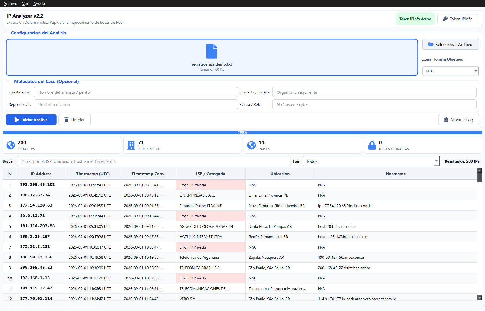

<div align="center">


# IP Analyzer

**Extracción de IPs e informes forenses local-first para escritorio.**

Extrae direcciones IPv4/IPv6 y timestamps de logs, los enriquece con geolocalización e ISP, convierte cualquier zona horaria y exporta un informe legal con cadena de custodia SHA256. 100% determinista — sin IA.

<a href="https://github.com/mikear/IP-Analyzer/releases/latest"></a>
<a href="README.md"></a>

<br>

[](https://github.com/mikear/IP-Analyzer/releases/latest)
[](https://github.com/mikear/IP-Analyzer/releases/latest)
[](https://www.python.org/)
[](https://www.qt.io/)
[](LICENSE)
[](#datos-y-privacidad)

<a href="assets/screenshots/03-analysis-results.png" title="Abrir la captura completa"></a>

**Windows x64** · **~120 MB** · **Sin administrador** · **Offline** · **MIT**

[Descarga](#descarga) · [Capturas](#capturas) · [Cómo funciona](#cómo-funciona) · [Documentación](README.md) · [English](README.md)

</div>

---

## Índice

- [Descarga](#descarga)
- [Por qué IP Analyzer](#por-qué-ip-analyzer)
- [Cómo funciona](#cómo-funciona)
- [Capacidades](#capacidades)
- [Capturas](#capturas)
- [Arranque rápido](#arranque-rápido)
- [Datos y privacidad](#datos-y-privacidad)
- [Compilar desde código](#compilar-desde-código)
- [Hoja de ruta](#hoja-de-ruta)
- [Documentación](#documentación)
- [Contribuir](#contribuir)
- [Seguridad](#seguridad)
- [Agradecimientos](#agradecimientos)
- [Licencia](#licencia)

## Descarga

**Sin administrador.** El instalador es per-user y el portable no instala nada.

| Plataforma | Instalador | Portable |
|---|---|---|
| Windows x64 | [Setup `.exe`](https://github.com/mikear/IP-Analyzer/releases/latest/download/IP-Analyzer-Setup-v2.2.0-win64.exe) | [ZIP](https://github.com/mikear/IP-Analyzer/releases/latest/download/IP-Analyzer-2.2.0-win64-portable.zip) · [CLI](https://github.com/mikear/IP-Analyzer/releases/latest/download/ip-analyzer-cli.exe) |

[Checksums SHA256](https://github.com/mikear/IP-Analyzer/releases/latest/download/SHA256SUMS.txt) · [Todas las releases](https://github.com/mikear/IP-Analyzer/releases)

- **Windows 10/11 x64.** Desinstala desde Configuración > Apps o `unins000.exe` — cierra la app y no deja archivos.
- Los builds v2.2 no están firmados; SmartScreen puede pedir confirmación.
- Sin token, IP Analyzer funciona **offline en modo local** (solo extracción + timestamps).

## Por qué IP Analyzer

- **Local-first:** los metadatos del caso y tu token se quedan en tu equipo. Solo vas a ipinfo.io cuando ejecutas un análisis.
- **Determinista:** regex + `ipaddress`, sin IA ni nube. Misma entrada → mismo resultado, siempre.
- **Listo para forense:** SHA256 del archivo de entrada, versión de la app, metadatos del caso (investigador, juzgado/fiscalía, causa) y rango de exportación en cada informe.
- **Exportación flexible:** PDF, CSV (`utf-8-sig` con `#` de metadatos), JSON y TXT — todos, filtrados o seleccionados.
- **Sin lock-in:** tus CSV se abren con `pandas.read_csv(ruta, comment='#')` y puedes recompilar desde fuente bajo MIT.

**Resumen:** IPv4/IPv6 · timestamps CLF + ISO + syslog · conversión universal de zona · GUI + CLI · 4 formatos de exportación.

## Cómo funciona

```
Logs no estructurados (.txt/.log/.csv/.docx)
  └─> Extracción determinista (IPv4/IPv6 + timestamps)
  └─> Enriquecimiento ipinfo.io (ciudad, región, país, ISP, hostname)
  └─> Conversión de zona horaria (zoneinfo, respaldo pytz)
  └─> Informe forense (PDF/CSV/JSON/TXT + SHA256)
```

1. **Arrastra tu archivo** — logs de auditoría no estructurados sirven.
2. **Elige zona horaria** — cualquier timestamp se convierte a ella (`UTC`, `UTC-3`, `America/Argentina/Buenos_Aires`, …).
3. **(Opcional) Metadatos del caso** — investigador, juzgado/fiscalía, causa.
4. **Inicia el análisis** — puedes cancelar en cualquier momento; la cancelación queda en los metadatos.
5. **Filtra y exporta** — busca por texto o país y exporta todos / filtrados / seleccionados.

## Capacidades

| Área | Qué incluye |
|---|---|
| Extracción | IPv4 e IPv6 (completa, sin truncar), timestamps ISO, `DD/MM/YYYY`, CLF Apache y syslog; pares `(ip, ts)` deduplicados |
| Enriquecimiento | ipinfo.io: ciudad, región, país, ISP, hostname; privadas/loopback/link-local sin llamar a la API; 3 reintentos con backoff y caché de errores |
| Zona horaria | `zoneinfo` primero, `pytz` respaldo; timestamps naive asumen UTC; `DD/MM/YYYY` día primero con aviso ante ambigüedad |
| GUI | PySide6/Qt drag & drop, análisis asíncrono `QThread`, tarjetas KPI (total/ISPs/países/privadas), log en vivo, barra de progreso, filtro por país con debounce, iconos FontAwesome |
| CLI | `main_cli.py <archivo> -o <salida> -tz <zona> -m "Clave=Valor"` (repetible), falla rápido con zona inválida |
| Informes | Metadatos del caso, SHA256 de origen y zona aplicada; CSV conserva líneas `#`; PDF latin-1 landscape con pie y numeración |

## Capturas

Análisis de 200 IPs con geolocalización e ISP

[](assets/screenshots/03-analysis-results.png)

## Arranque rápido

### GUI

```bash
python src/ip_analyzer_gui.py
```

1. Arrastra tu archivo al panel de entrada o usa **Seleccionar Archivo**.
2. Elige la zona horaria de conversión.
3. (Opcional) Ingresa metadatos del caso.
4. **Iniciar Análisis**. Cancela con **Cancelar**.
5. Examina resultados, busca o filtra por país (ver **Mostrar Log**).
6. Exporta desde **Archivo > Exportar Informe...** (PDF, CSV, JSON, TXT) — todos, filtrados o seleccionados.

### CLI

```bash
python src/main_cli.py "C:\evidencia\log_auditoria.txt" -o "C:\informes\caso123" -tz "America/Argentina/Buenos_Aires" -m "Investigador=Diego Rabalo" -m "Causa=123/2025"
```

Notas:

- `-m` acepta `clave=valor` (con o sin comillas) y se puede repetir.
- `-tz` se valida antes de analizar: una zona inexistente termina con error sin llamar a la API.
- El CSV incluye metadatos como líneas `#`; léelo con `pandas.read_csv(ruta, comment='#')`.
- Las fechas `DD/MM/AAAA` se interpretan día primero; si día y mes son ambiguos se emite un aviso.

### Token (IPInfo API)

El enriquecimiento necesita un token — o usa solo el modo local:

- En la GUI: **Archivo > Gestionar Token IPInfo...**
- O crea un `.env` con `IPINFO_TOKEN=tu_token`:

| Modo | Ruta del `.env` |
|---|---|
| Código fuente | `src/.env` |
| Instalado (setup) | `%APPDATA%\IP-Analyzer\.env` |
| Portable | junto a `IP-Analyzer.exe` |

## Datos y privacidad

- Los archivos de entrada se leen localmente; los pares extraídos nunca salen de tu equipo salvo por la llamada a ipinfo.io que vos disparás.
- Tu token se guarda en `.env` (ruta según modo) con `python-dotenv` y nunca aparece en los logs.
- Las únicas llamadas de red son el enriquecimiento vía ipinfo.io (y un test contra `8.8.8.8` desde el diálogo). Sin telemetría, sin cuentas.
- Los informes incorporan el SHA256 del archivo de entrada para cadena de custodia — conservá el original y el informe juntos. Ver [DISCLAIMER.md](DISCLAIMER.md).

## Compilar desde código

Requisitos: Python 3.10+ y `pip install -r requirements.txt`.

```bash
python -m venv venv
.\venv\Scripts\activate   # Windows
pip install -r requirements.txt
python -m compileall src scripts
```

Build de release (GUI + CLI + zip + instalador Inno + checksums):

```bash
python scripts/build_release.py
python scripts/build_release.py --skip-gui --skip-cli   # rápido: solo zip + instalador + checksums
```

La versión vive en `APP_VERSION` en `src/ip_analyzer_gui.py` (`"2.2"` → `2.2.0`) — bájala ahí, nunca en el script.

## Hoja de ruta

- Firma de código en Windows.
- Más formatos de timestamp bajo demanda.
- Enriquecimiento masivo más rápido y resúmenes de exportación parcial.

¿Te falta un caso de uso? Abrí una [discusión](https://github.com/mikear/IP-Analyzer/discussions) o un [issue](https://github.com/mikear/IP-Analyzer/issues).

## Documentación

- [README.md](README.md) — documentación completa en inglés (mismo contenido)
- [LEEME.txt](LEEME.txt) — resumen rápido en español
- [RELEASE_NOTES.md](RELEASE_NOTES.md) — notas de release
- [DISCLAIMER.md](DISCLAIMER.md) — uso autorizado y avisos sobre fuentes de datos

## Contribuir

Se aceptan contribuciones: reportes de bugs, ideas de formatos de timestamp, mejoras de UI, traducciones y correcciones de documentación.

- Leé [CONTRIBUTING.md](CONTRIBUTING.md) y el [Código de Conducta](CODE_OF_CONDUCT.md).
- Usá las plantillas de [bug report](https://github.com/mikear/IP-Analyzer/issues/new?template=bug_report.yml) o [feature request](https://github.com/mikear/IP-Analyzer/issues/new?template=feature_request.yml).
- Nunca abras un issue público por una vulnerabilidad; ver [SECURITY.md](SECURITY.md).

## Seguridad

IP Analyzer es una herramienta defensiva para trabajo de seguridad autorizado. Reportá vulnerabilidades en privado vía [GitHub Security Advisories](https://github.com/mikear/IP-Analyzer/security/advisories/new) y leé [SECURITY.md](SECURITY.md) para alcance y tiempos de respuesta.

## Agradecimientos

- ipinfo.io por datos de geolocalización e ISP.
- Qt / PySide6, fpdf2, python-docx, python-dateutil y pytz.
- Avisos de terceros en [NOTICE](NOTICE).

## Licencia

MIT — ver [LICENSE](LICENSE). IP Analyzer está pensado para profesionales de seguridad autorizados.

Si IP Analyzer te sirve, una estrella ayuda a que otros lo encuentren.

[](https://github.com/mikear/IP-Analyzer)
