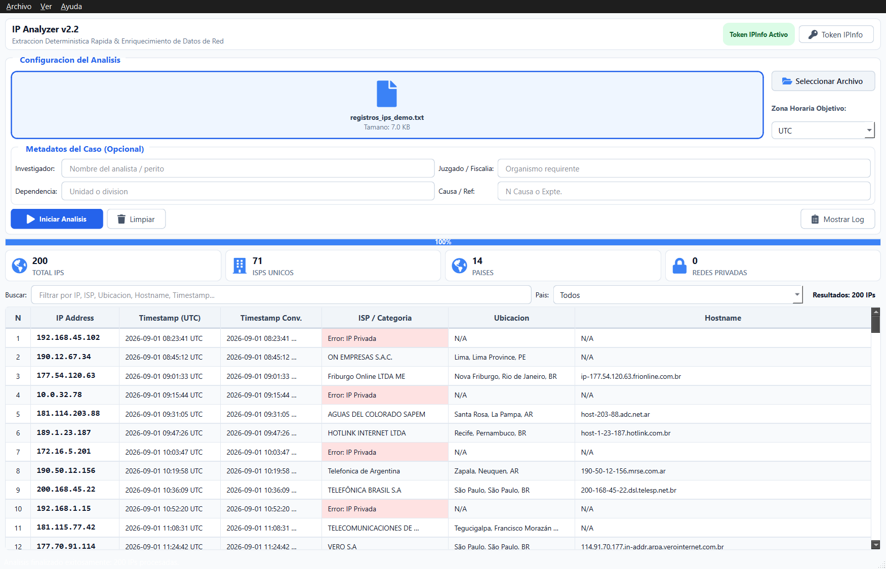

<div align="center">


# IP Analyzer

**Local-first IP extraction and forensic reporting for the desktop.**

Extract IPv4/IPv6 addresses and timestamps from logs, enrich them with geolocation and ISP data, convert any timezone, and export a legal-grade report with SHA256 chain of custody. 100% deterministic — no AI involved.

<a href="https://github.com/mikear/IP-Analyzer/releases/latest"></a>
<a href="README.es.md"></a>

<br>

[](https://github.com/mikear/IP-Analyzer/releases/latest)
[](https://github.com/mikear/IP-Analyzer/releases/latest)
[](https://www.python.org/)
[](https://www.qt.io/)
[](LICENSE)
[](#data-and-privacy)

<a href="assets/screenshots/03-analysis-results.png" title="Open the full screenshot"></a>

**Windows x64** · **~120 MB** · **No admin required** · **Works offline** · **MIT**

[Download](#download) · [Screenshots](#screenshots) · [How it works](#how-it-works) · [Documentation](README.es.md) · [Español](README.es.md)

</div>

---

## Contents

- [Download](#download)
- [Why IP Analyzer](#why-ip-analyzer)
- [How it works](#how-it-works)
- [Features](#features)
- [Screenshots](#screenshots)
- [Quick start](#quick-start)
- [Data and privacy](#data-and-privacy)
- [Build from source](#build-from-source)
- [Roadmap](#roadmap)
- [Documentation](#documentation)
- [Contributing](#contributing)
- [Security](#security)
- [Acknowledgements](#acknowledgements)
- [License](#license)

## Download

**No admin rights required.** The installer is per-user; the portable build installs nothing.

| Platform | Installer | Portable |
|---|---|---|
| Windows x64 | [Setup `.exe`](https://github.com/mikear/IP-Analyzer/releases/latest/download/IP-Analyzer-Setup-v2.2.0-win64.exe) | [ZIP](https://github.com/mikear/IP-Analyzer/releases/latest/download/IP-Analyzer-2.2.0-win64-portable.zip) · [CLI](https://github.com/mikear/IP-Analyzer/releases/latest/download/ip-analyzer-cli.exe) |

[SHA256 checksums](https://github.com/mikear/IP-Analyzer/releases/latest/download/SHA256SUMS.txt) · [All releases](https://github.com/mikear/IP-Analyzer/releases)

- **Windows 10/11 x64.** Uninstall from Settings > Apps or `unins000.exe` — the uninstaller kills the app and leaves zero files.
- The v2.2 builds are not code-signed; SmartScreen may ask for confirmation.
- Without a token, IP Analyzer runs **offline in local mode** (extraction + timestamps only).

## Why IP Analyzer

- **Local-first:** case metadata and your token stay on your machine. Only enrichment calls go to ipinfo.io, and only when you run an analysis.
- **Deterministic:** regex + `ipaddress` parsing, no AI, no cloud. Same input → same result, every time.
- **Forensic-ready:** SHA256 of the source file, app version, case metadata (investigator, court/prosecutor, case number), and export-range tracking in every report.
- **Flexible exports:** PDF, CSV (`utf-8-sig` with `#` metadata), JSON, and TXT — all, filtered-only, or selected-only.
- **No lock-in:** your CSVs open in pandas with `pandas.read_csv(ruta, comment='#')`, and you can rebuild from source under MIT.

**At a glance:** IPv4/IPv6 · CLF + ISO + syslog timestamps · universal timezone conversion · GUI + CLI · 4 export formats.

## How it works

```
Unstructured logs (.txt/.log/.csv/.docx)
  └─> Deterministic extraction (IPv4/IPv6 + timestamps)
  └─> ipinfo.io enrichment (city, region, country, ISP, hostname)
  └─> Timezone conversion (zoneinfo, pytz fallback)
  └─> Forensic report (PDF/CSV/JSON/TXT + SHA256)
```

1. **Drop your file** — unstructured audit logs are fine.
2. **Pick a timezone** — any timestamp is converted to it (`UTC`, `UTC-3`, `America/Argentina/Buenos_Aires`, …).
3. **(Optional) Add case metadata** — investigator, court/prosecutor, case reference.
4. **Run the analysis** — cancel any time; cancellation is noted in the report metadata.
5. **Filter & export** — search by text or country, then export all / filtered / selected.

## Features

| Area | What you get |
|---|---|
| Extraction | IPv4 and IPv6 (full, no truncation), ISO, `DD/MM/YYYY`, CLF Apache, syslog timestamps; de-duplicated `(ip, ts)` pairs |
| Enrichment | ipinfo.io: city, region, country, ISP, hostname; private/loopback/link-local skipped without API calls; 3 retries with backoff, error caching |
| Timezone | `zoneinfo` first, `pytz` fallback; naive timestamps assumed UTC; day-first `DD/MM/YYYY` with ambiguity warning |
| GUI | PySide6/Qt drag & drop, `QThread` async analysis, KPI cards (total/ISPs/countries/private), live log, progress bar, country filter with debounce, FontAwesome icons |
| CLI | `main_cli.py <file> -o <out> -tz <zone> -m "Key=Value"` (repeatable), fails fast on invalid timezone |
| Reports | Case metadata, source SHA256, applied timezone; CSV keeps `#` metadata lines; PDF is latin-1 landscape with footer and page numbers |

## Screenshots

Analysis of 200 IPs with geolocation and ISP

[](assets/screenshots/03-analysis-results.png)

## Quick start

### GUI

```bash
python src/ip_analyzer_gui.py
```

1. Drag your file onto the input panel or use **Select File**.
2. Choose the conversion timezone.
3. (Optional) Enter case metadata.
4. **Start Analysis**. Cancel any time with **Cancel**.
5. Browse results, search, or filter by country (see **Show Log** for the execution console).
6. Export from **File > Export Report...** (PDF, CSV, JSON, TXT) — all, filtered, or selected only.

### CLI

```bash
python src/main_cli.py "C:\evidence\audit_log.txt" -o "C:\reports\case123" -tz "America/Argentina/Buenos_Aires" -m "Investigator=Diego Rabalo" -m "Case=123/2025"
```

Notes:

- `-m` accepts `key=value` (quoted or not) and can be repeated.
- `-tz` is validated before analysis: an invalid zone exits with an error without calling the API.
- The CSV includes case metadata as `#` lines; read it with `pandas.read_csv(path, comment='#')`.
- `DD/MM/YYYY` dates are day-first; ambiguous day/month values log a warning.

### Token (IPInfo API)

Enrichment needs a token — or just run local-only:

- In the GUI: **File > Manage IPInfo Token...**
- Or create a `.env` with `IPINFO_TOKEN=your_token_here`:

| Mode | `.env` location |
|---|---|
| Source | `src/.env` |
| Installed (setup) | `%APPDATA%\IP-Analyzer\.env` |
| Portable | next to `IP-Analyzer.exe` |

## Data and privacy

- Input files are read locally; extracted pairs never leave your machine except for the ipinfo.io call you trigger.
- Your token is stored in `.env` (mode-aware path above) via `python-dotenv` and never appears in logs.
- The only network calls are ipinfo.io enrichment (and a token test against `8.8.8.8` from the dialog). No telemetry, no account.
- Reports embed the source file SHA256 for chain of custody — keep the original and the report together. See [DISCLAIMER.md](DISCLAIMER.md).

## Build from source

Requirements: Python 3.10+ and `pip install -r requirements.txt`.

```bash
python -m venv venv
.\venv\Scripts\activate   # Windows
pip install -r requirements.txt
python -m compileall src scripts
```

Build the release (GUI + CLI + zip + Inno installer + checksums):

```bash
python scripts/build_release.py
python scripts/build_release.py --skip-gui --skip-cli   # fast: only zip + installer + checksums
```

The version lives in `APP_VERSION` in `src/ip_analyzer_gui.py` (`"2.2"` → `2.2.0`) — bump it there, never in the script.

## Roadmap

- Code signing on Windows.
- Additional timestamp formats on demand.
- Faster batch enrichment and partial-export summaries.

Have a use case that is missing? Open a [discussion](https://github.com/mikear/IP-Analyzer/discussions) or an [issue](https://github.com/mikear/IP-Analyzer/issues).

## Documentation

- [README.es.md](README.es.md) — full Spanish documentation (same content)
- [LEEME.txt](LEEME.txt) — Spanish quick-start summary
- [RELEASE_NOTES.md](RELEASE_NOTES.md) — release notes
- [DISCLAIMER.md](DISCLAIMER.md) — authorized use and data source notices

## Contributing

Contributions are welcome: bug reports, timestamp-format ideas, UI improvements, translations, and documentation fixes.

- Read [CONTRIBUTING.md](CONTRIBUTING.md) and the [Code of Conduct](CODE_OF_CONDUCT.md).
- Use the [bug report](https://github.com/mikear/IP-Analyzer/issues/new?template=bug_report.yml) or [feature request](https://github.com/mikear/IP-Analyzer/issues/new?template=feature_request.yml) templates.
- Never open a public issue for a vulnerability; see [SECURITY.md](SECURITY.md).

## Security

IP Analyzer is a defensive tool for authorized security work. Report vulnerabilities privately through [GitHub Security Advisories](https://github.com/mikear/IP-Analyzer/security/advisories/new) and read [SECURITY.md](SECURITY.md) for scope and response times.

## Acknowledgements

- ipinfo.io for geolocation and ISP data.
- Qt / PySide6, fpdf2, python-docx, python-dateutil, and pytz.
- Third-party notices are listed in [NOTICE](NOTICE).

## License

MIT — see [LICENSE](LICENSE). IP Analyzer is intended for authorized security professionals.

If IP Analyzer is useful, a star helps others find it.

[](https://github.com/mikear/IP-Analyzer)
